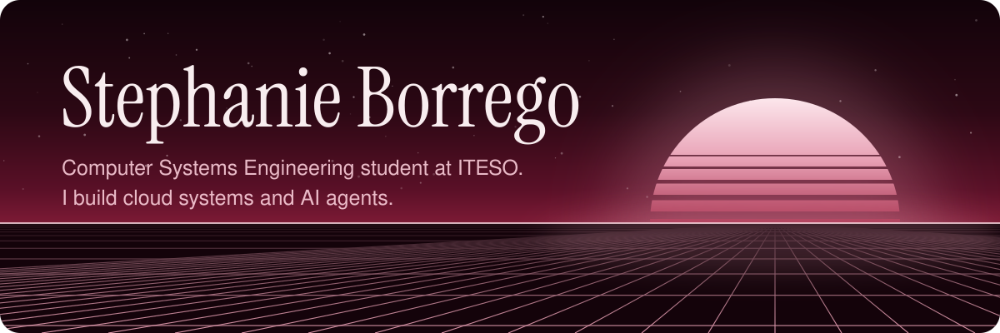
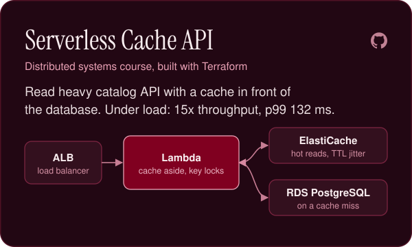
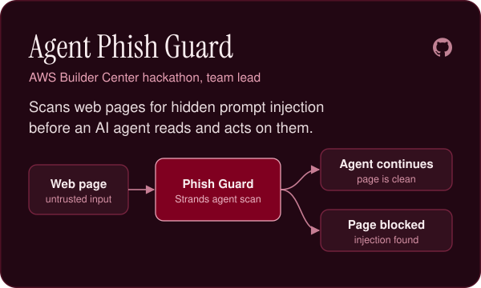
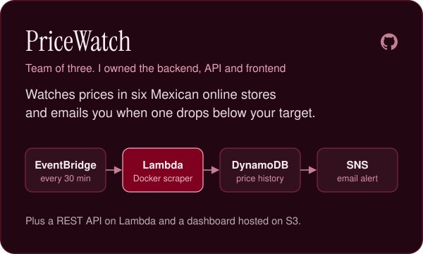
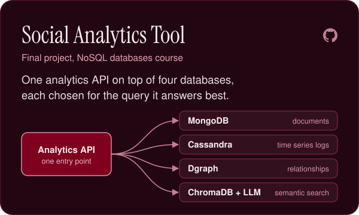
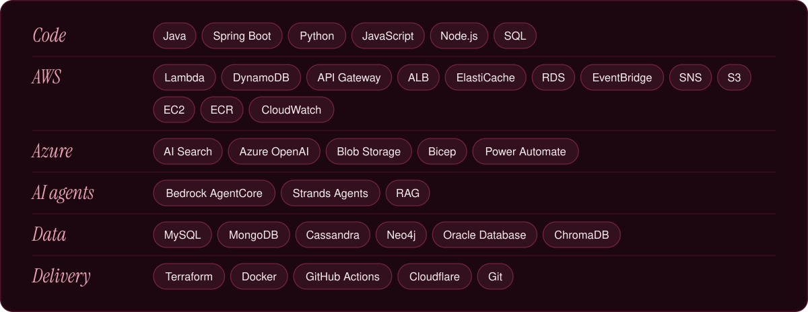

## About me

Hi, I'm Stephanie (Steph). I study Computer Systems Engineering at ITESO in Guadalajara, Mexico, and I work as a Customer Success Engineer intern at Toshiba.

I like turning slow, manual work into small systems that run on their own: serverless backends on AWS, infrastructure as code, and lately AI agents.

I'm always up for learning something new, and open to opportunities where I can keep growing as an engineer.

## Things I've built

  
  

  
  

More on AWS, all provisioned with Terraform:

- [Live event telemetry pipeline](https://github.com/stephy0410/aws-live-event-telemetry-pipeline): one Kinesis stream fanned out by Lambda consumers into DynamoDB, SNS and SQS alerts, Redshift with Grafana, and an S3 data lake queried with Athena
- [High availability web tier](https://github.com/stephy0410/aws-high-availability-lab): a load balancer in front of an Auto Scaling group that grows from 1 to 3 instances on CPU, with real HTTPS

## What I work with

  

